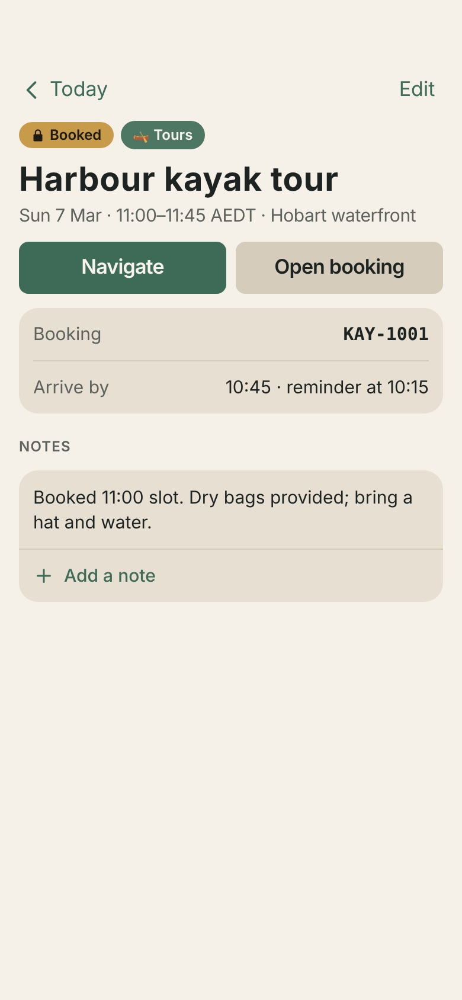
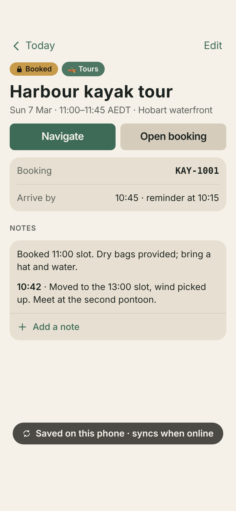
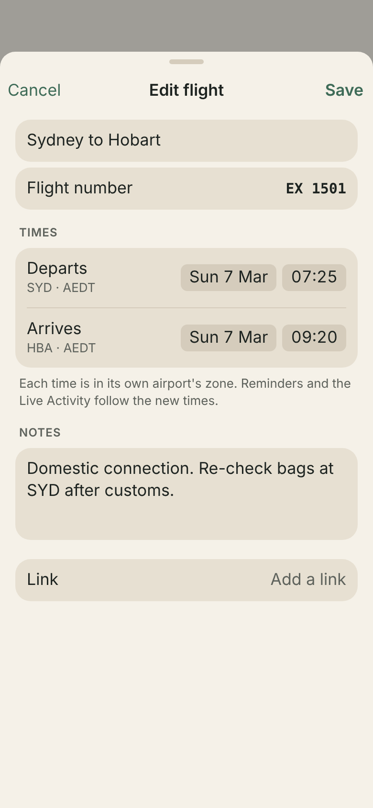
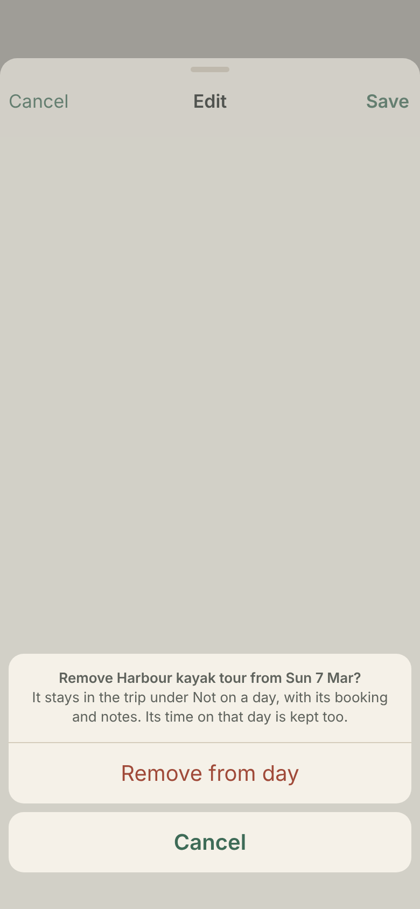
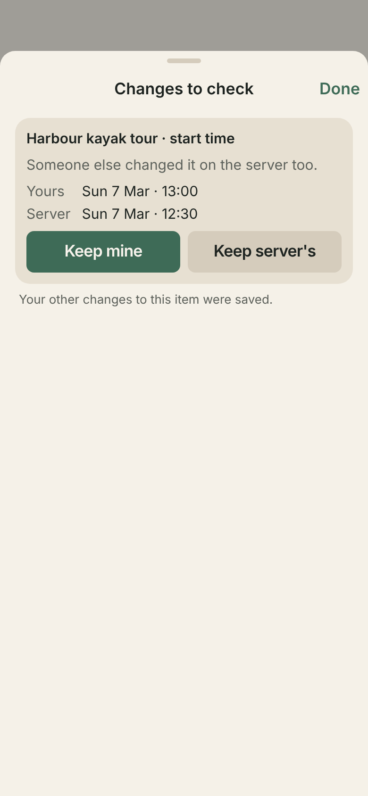
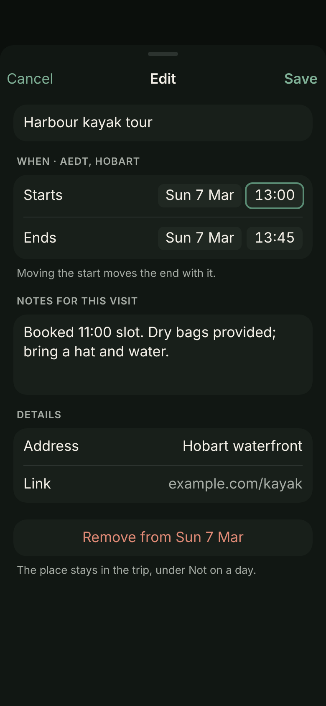

# Editing trip items — signed off (issue #22)

Mockups for editing an item's notes, times and details in the app, plus adding notes to a day. They use only design-system components and tokens (`Design/tokens.json`) and the synthetic Tasmania trip. Signed off on 11 Oct 2026.

| Screen | What it shows |
| --- | --- |
|  Item detail | **Edit** in the toolbar for every item, and **Add a note** at the bottom of the notes card. |
|  Add a note | A short sheet with one text field. The note goes under the existing notes, with the time it was written (in the item's zone). Notes added this way never conflict with someone else's edits. |
|  Note added | It shows at once; the toast says it's saved on the phone and syncs when the phone is online. |
|  Edit a place | Name, start and end in the place's zone (the zone is named in the section header), notes for this visit, address and link. Moving the start keeps the length. **Remove from Sun 7 Mar** sits at the bottom. |
|  Edit a flight | Flight number in mono; departure and arrival each in their own airport's zone. Stays and other journeys follow the same layout (check-in/check-out and booking reference for stays). |
|  Remove from a day | Confirms first. The item stays in the trip under Not on a day; its booking, notes and time are kept. |
|  Add to a day | A **+** on the trip's day view: a note on this day, or a trip-wide note. Adding a place comes later (it needs place search), so the app leaves the greyed-out Place entry out until then. |
|  New note | Title and text. It goes at the end of the day and can be dragged into place. |
|  Conflict | When someone else changed the same field, both values are shown with **Keep mine** and **Keep server's**. The edit's other fields are saved meanwhile. |
|  Edit a place · dark | The same sheet on the dark palette. |

## Rules these follow

- Every edit is saved on the phone first and replayed onto the server's current copy when sent, like ticks and note edits (`docs/PLAN.md`, "How Stage 2 syncs").
- Each field remembers the value it started from. A field nobody else touched is saved; a field someone else changed asks which to keep. Long text (notes) and short fields (times, names) work the same way.
- Collaborators on a shared trip can edit items like the owner. The trip itself (name, dates, sharing) stays out of the app.
- Reminders, geofences and the Live Activity follow edited times, as they already do when a trip changes.
