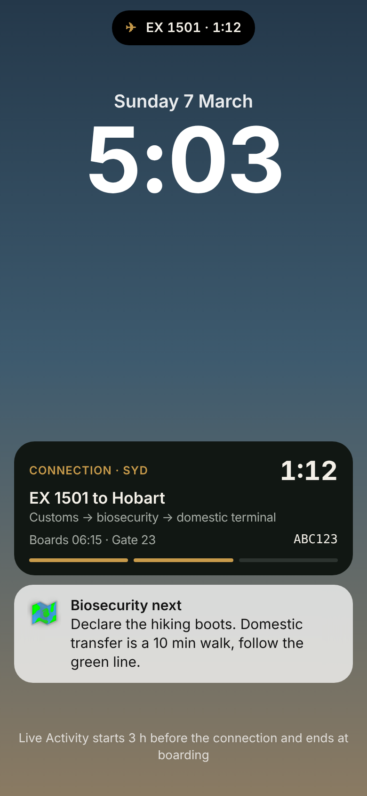
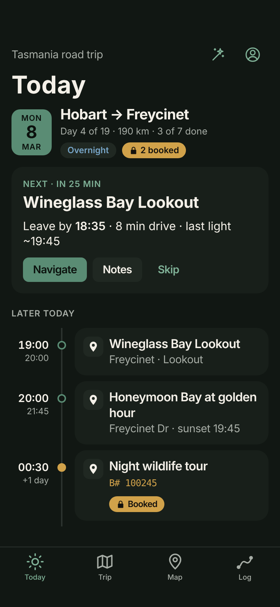
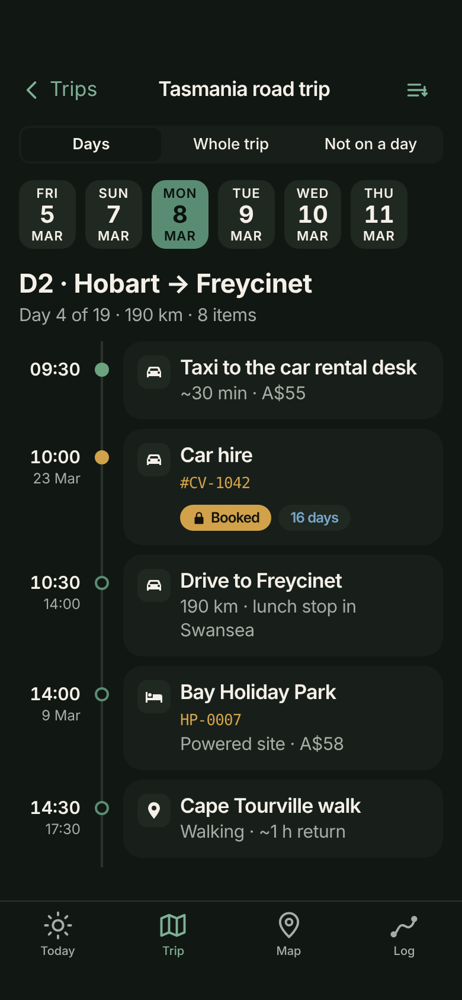

# Design review 1 — signed off

Mockups of every MVP screen, built only from components in the **AdventureLog iOS** design system (`Design/tokens.json`). Signed off on 11 Oct 2026. Stage 1 and Stage 2 screens are built to match these, and design review 2 puts Simulator snapshots beside them.

| Screen | Built in | Notes locked in |
| --- | --- | --- |
|  Sign in | Stage 1 | Server address and API key only; the key field is monospaced. "Works with AdventureLog 0.13 or later." |
|  Today | Stage 2 | Day header, a Next up card with the leave-by time and Navigate / Notes / Skip, then the rest of the day as a timeline. Booked items use the ochre accent and a lock. |
|  Trip · day | Stage 1 | A Days / Whole trip / Not on a day switch, a date strip, then the day's timeline. Done items are dimmed; booked items show their reference. |
|  Item detail | Stage 1 | The booking reference copies on tap. Navigate is the primary action. Booked items say they are never moved by a replan. |
|  Map | Stage 1 pins, Stage 3 routes | Planned route dashed, the actual track solid, unplanned stops as small green dots. |
|  Trips | Stage 1 | Happening now, then upcoming, shared with you, and past. |
|  Log | Stage 3, export Stage 6 | Stat tiles and plan vs actual (actual time over planned time), with Done / New / Late / Moved badges. |
|  Replan proposal | Stage 5 | A sheet listing each change. Booked items stay locked and are listed first. Apply / Not now, plus a free-text ask. |
|  Lock Screen | Stage 4 | The Live Activity always uses the dark live palette, whatever the system appearance. The countdown uses system timer text, and the leg bar fills in ochre. |
|  Today · dark | Stage 2 | The same layout on AdventureLog's dark palette. |
|  Trip · day · dark | Stage 1 | |

Map artwork is illustrative only; the app uses MapKit.
