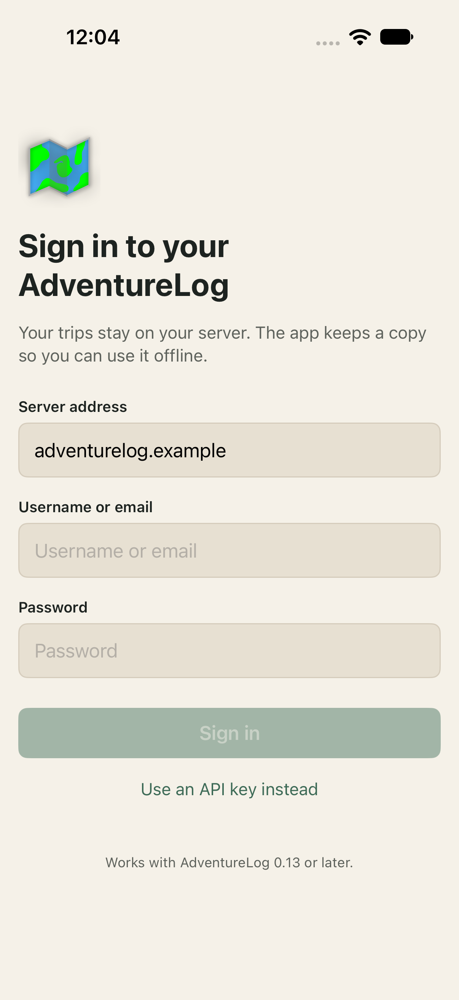
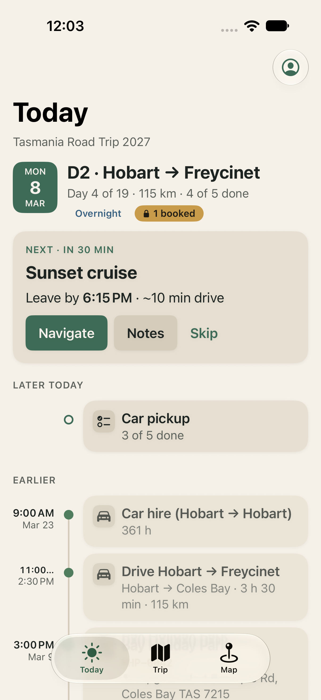
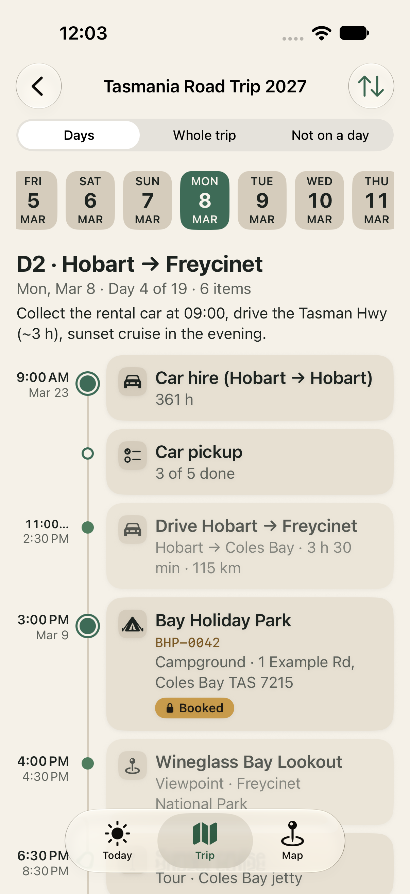
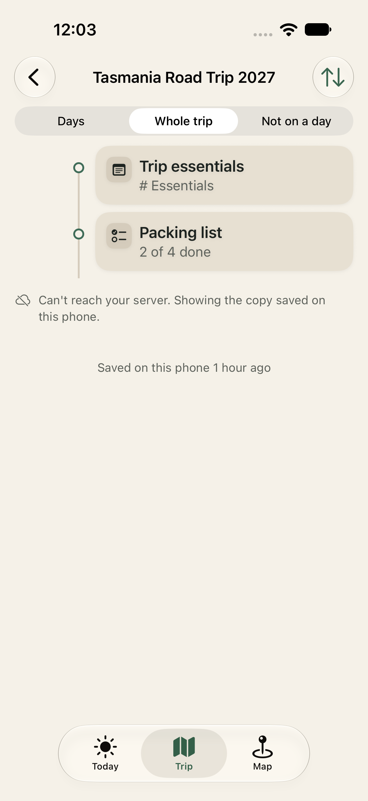
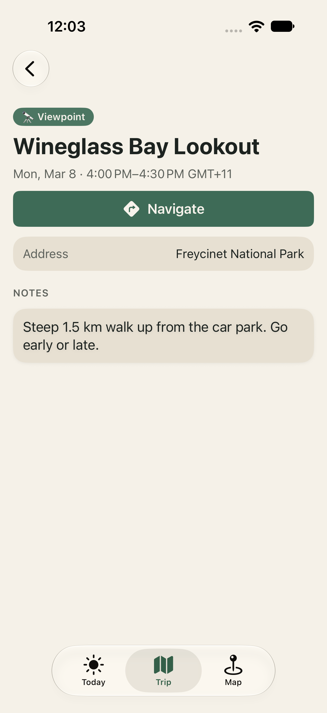
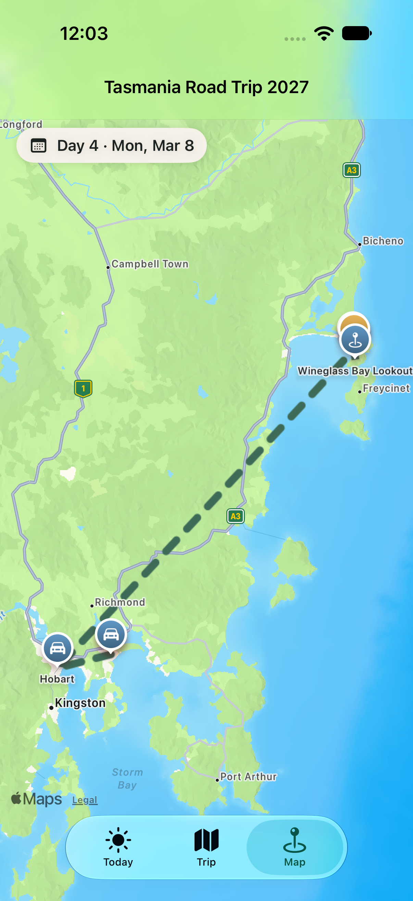
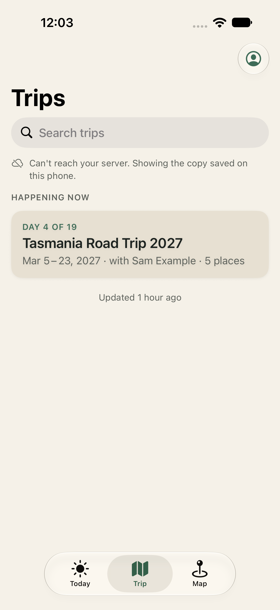

# Design review 2 — Simulator snapshots

Simulator snapshots of every screen built so far (Stages 1 and 2), taken from the synthetic "Tasmania Road Trip 2027" seed
with the `GalleryUITests` suite, beside the review 1 mockups. Each screen is in light, dark and the largest accessibility
text size (Dynamic Type XXL). Captured on the iPhone 18 Pro simulator, iOS 27.0, with `make gallery` (set
`AL_SIMULATOR_UDID` to pick a device); regenerate them the same way for review 3.

Log, Replan proposal and Lock Screen are Stage 3 to 5 screens and are not in the app yet.

| Screen | Mockup (review 1) | Snapshot, light | Dark | XXL |
| --- | --- | --- | --- | --- |
| Sign in |  |  | [dark](01-sign-in-dark.png) | [XXL](01-sign-in-xxl.png) |
| Today |  |  | [dark](02-today-dark.png) · mockup: [dark](../review-1/10-today-dark.png) | [XXL](02-today-xxl.png) |
| Trip · day |  |  | [dark](03-trip-day-dark.png) · mockup: [dark](../review-1/11-trip-day-dark.png) | [XXL](03-trip-day-xxl.png) |
| Trip · whole trip | no mockup |  | [dark](03b-whole-trip-dark.png) | [XXL](03b-whole-trip-xxl.png) |
| Item detail |  |  | [dark](04-item-detail-dark.png) | [XXL](04-item-detail-xxl.png) |
| Map |  |  | [dark](05-map-dark.png) | [XXL](05-map-xxl.png) |
| Trips |  |  | [dark](06-trips-dark.png) | [XXL](06-trips-xxl.png) |

## Things noticed while collecting these

Not a review result; the checklist in [`../README.md`](../README.md) is still to be worked through by the reviewer.

- **Time column truncates.** On Today, in the "Earlier" list, a two-digit-hour time shows as "11:00…" in light and dark
  ([`02-today-light.png`](02-today-light.png)). Tracked in issue 7.
- **Dynamic Type XXL.** Titles wrap onto several lines and are not cut off on Trip · day
  ([`03-trip-day-xxl.png`](03-trip-day-xxl.png)); the rest of the XXL set has not been checked line by line.
- The floating tab bar sits over the last visible row of each scrolling screen; the content scrolls beneath it.
- Mockup and snapshot differ in device size and in the data shown, so compare layout and components, not exact positions.

Sign-off: pending.
